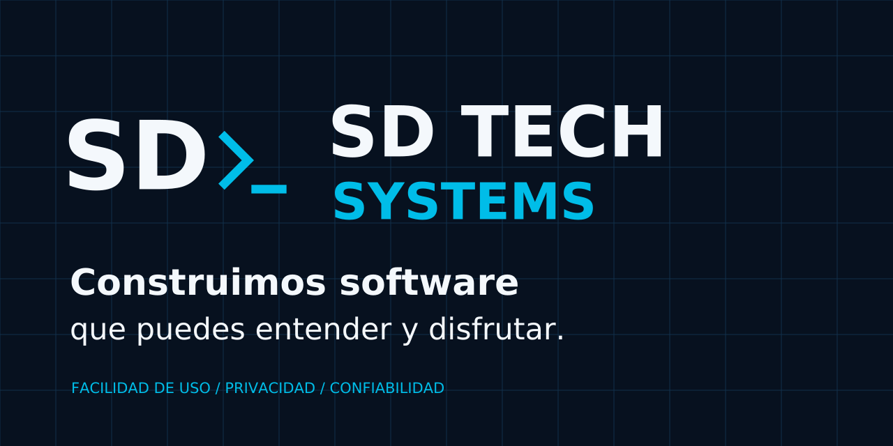

<p align="center">
  
</p>

# personality-traits

Choose how your AI agent works. Give it one or more traits, such as lean, diligent, cautious or proactive, and it changes how it codes, decides and reports to match.

```bash
npx skills add sdtechsystems/personality-traits
```

Install only the ones you want:

```bash
npx skills add sdtechsystems/personality-traits --skill trait-composer --skill trait-lean
```

## Use

Tell the agent in a message, or put it in your project's `CLAUDE.md` / `AGENTS.md`:

```
Traits: lean, cautious
```

or pick a preset:

```
Preset: production
```

## Traits

| Trait | How it works | Use it for |
|---|---|---|
| `trait-lean` | Shortest path that fully works. No extras. | Prototypes, scripts |
| `trait-diligent` | Finishes completely: tested, documented, tidy. | Client work, releases |
| `trait-cautious` | Small, reversible steps with a way back. | Production, real data |
| `trait-attentive` | Catches details and remembers what you said. | Reviews, long specs |
| `trait-proactive` | Asks for permissions up front, spots automation, suggests the right settings. | Long or unattended runs |
| `trait-dependent` | Checks in before each real decision, with options. | Learning, sensitive work |

`trait-composer` combines them and settles conflicts: **cautious > diligent > attentive > proactive > lean > dependent**. So `lean + diligent` gives you the smallest solution, *with* its test.

## Same request, different traits

> **You:** add a dark mode toggle

| Trait | Response |
|---|---|
| lean | One toggle using the existing CSS variables. 1 file, 14 lines. Didn't add persistence. |
| diligent | Toggle, persisted choice, system default, 3 tests, contrast checked, README updated. |
| cautious | Added behind a feature flag, off by default. Light theme verified unchanged. |
| attentive | Used your brand tokens. Noticed the dark logo will vanish on the dark background. |
| proactive | Done. Next: a white logo variant and a screenshot test for both themes. Want them? |
| dependent | Two decisions first: remember the choice? Follow the system setting? I'd say yes to both. |

## Presets

| Preset | Traits |
|---|---|
| `startup` | lean + proactive |
| `production` | cautious + diligent + attentive |
| `client` | diligent + attentive + proactive |
| `learning` | dependent + diligent |
| `scripts` | lean |
| `autopilot` | proactive + cautious |

## Limits every trait keeps

No trait, however "lazy" or autonomous, will:

1. Skip confirmation for irreversible or outward-facing actions (delete, push, deploy, send, pay).
2. Disable tests, validations or security checks to go faster.
3. Grant itself permissions or edit its own configuration.
4. Report "done" without checking.

## Pairs well with

[common-sense](https://github.com/sdtechsystems/common-sense): the baseline judgment (time, place, intent, cost) every trait builds on.

## Security

Markdown only: no scripts, no network calls, no access to secrets. See [SECURITY.md](SECURITY.md).

## License

[MIT](LICENSE)

---

Developed by **SD Tech Systems** · Part of SD Tech
